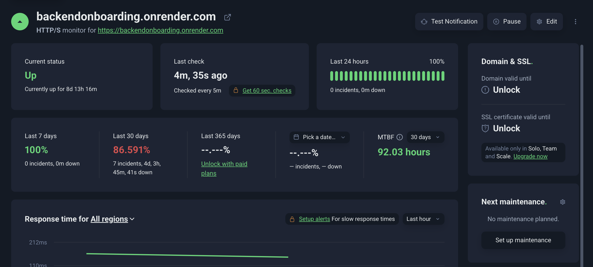
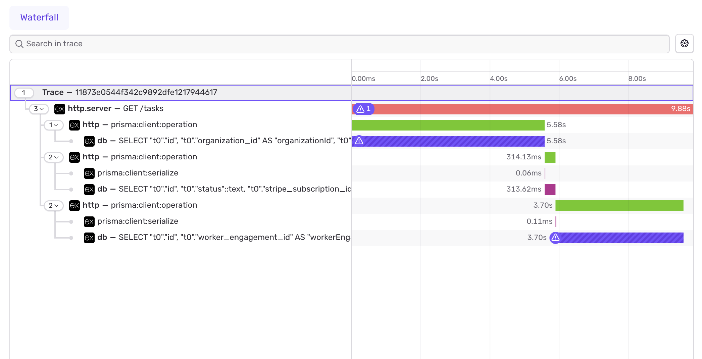
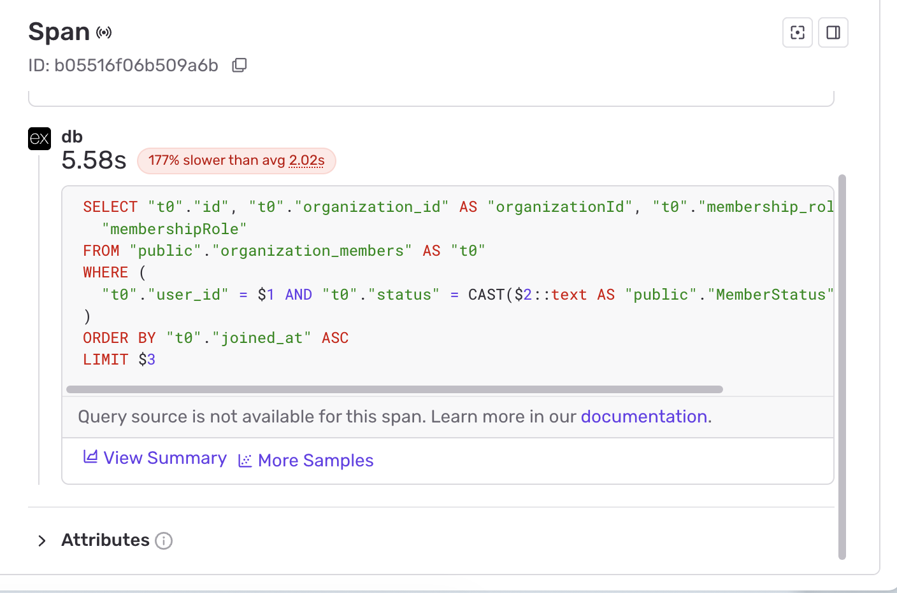

# Observability Deep Dive — PRs #225 and #226

API: Render web service (Express + Prisma)
PRs: [#225](https://github.com/MaddoxSciuchetti/Handwerk-HR/pull/225), [#226](https://github.com/MaddoxSciuchetti/Handwerk-HR/pull/226)

SE_46 evidence for the observability side of Performance, Scaling, and Observability.

---

## Purpose

I once visited a user who tried a new feature. The feature failed. I had no request ids and no tracing yet. I spent a long time searching for the error. I could not see what went wrong right away.

That experience is why I built #225 and #226. I can now find problems much faster.

What I added:

- Clear JSON logs (pino) in Render
- A request id on every important call
- Sentry for crashes and slow requests
- Sentry Crons check-ins for the two Render cron jobs
- A Sentry metric alert when API request latency gets too high
- UptimeRobot to check if the server is reachable at all

What I would do differently next time:

1. I first turned on OpenTelemetry and Sentry together. That was a mistake. Two tracing systems fought each other. Now, when `SENTRY_DSN` is set, Sentry alone owns tracing.
2. Use Sentry for traces in staging and production (this is what we do now).
3. Run the load probe on staging and save the numbers — done in [load-probe.md](./load-probe.md).

---

## PR #225 — Clear logs and request ids

How to use the logger day to day: [logging.md](./logging.md).

### What I did

I stopped using loose `console.*` calls on important paths. The app now uses one shared pino logger.

Every request gets an id (`X-Request-Id`). That id stays with the request. When the response finishes, one access log line is written. It includes how long the call took, the status code, and the path.

Simple checks like `/` stay quiet in the logs when they succeed. That keeps Render logs readable.

The logger also attaches useful fields when they exist: request id, user id, org id. Passwords and tokens are removed from logs.

When the API returns a 500, the JSON body includes the request id. I can copy that id and search for it in Render.

### Effect

If something fails, I copy the request id. I paste it into Render logs. I see the matching lines for that same request. That is much better than guessing while sitting with a user.

### Learning

The request id on the response mattered most. Quiet health/root logs also helped. Deploy noise no longer hides real failures.

---

## PR #226 — Sentry for errors and slow requests

### What I did

Logs in Render are still useful. Sentry adds a UI on top so I do not only grep text files.

The server starts Sentry early in `instrument.ts`, before the rest of the app. When `SENTRY_DSN` is set, my old OpenTelemetry startup is skipped. That avoids the dual-tracing mistake.

Unexpected 500s show up as Sentry issues. We still write normal logs to Render.

```ts
// server/src/instrument.ts
import * as Sentry from "@sentry/node";
import { NODE_ENV, SENTRY_DSN } from "@/constants/env";

if (SENTRY_DSN) {
    Sentry.init({
        dsn: SENTRY_DSN,
        environment: NODE_ENV,
        tracesSampleRate: NODE_ENV === "production" ? 0.1 : 1.0,
    });
}
```

```ts
// server/src/index.ts — use Sentry for tracing when the DSN is set
import { isSentryEnabled } from "./instrument";
import { startTracing } from "./observability/tracing";

if (!isSentryEnabled) {
    startTracing(); // only when Sentry is off
}
```

The frontend also uses Sentry (`VITE_SENTRY_DSN` at build time). I attach the request id, org id, and user id in Sentry. Then an issue matches what I search in Render.

### Effect

I use Render when I already have a request id and want the full log story. I use Sentry when I want grouped crashes or alerts about slow or failing routes. UptimeRobot can still say the host is up while Sentry shows real problems.

### Learning

Only one system should own tracing. The frontend DSN must be present at build time. The API DSN is a runtime setting on Render. Easy to mix up across two services.

---

## UptimeRobot versus Sentry

UptimeRobot answers a simple question: is the server reachable?

It calls the production API about every five minutes. The check hits `GET /` on `backendonboarding.onrender.com`. That route only returns the text `here`. It is not a special `/health` route.

Sentry answers a different question: is the server up, but still failing or slow for real users?



UptimeRobot and Sentry work together: the ping can stay green while Sentry already shows slow or failing requests.

---

## Sentry metric alert — slow API requests

We use Sentry’s alert system for latency, not only for crashes.

In org `hadox`, project `handwerk-hr-server`, there is an active metric alert:

| Field | Value |
| --- | --- |
| Name | `API p95 latency too high` |
| Rule id | `2705868` |
| Environment | `staging` |
| Query | `span.op:http.server` |
| Aggregate | `p95(span.duration)` |
| Window | 10 minutes |
| Warning | above 1500 ms |
| Critical | above 2000 ms |

When the rule fires, it is linked to the existing high-priority email alert, so I get notified.

Where to find it in the UI: Alerts → left sidebar Monitor Type → Metric (the default Alerts table only lists issue notifications). Direct link: [rule 2705868](https://hadox.sentry.io/alerts/rules/details/2705868/).

Created with the Sentry CLI (`sentry alert metrics create`), not only in the web UI.

A matching rule for production can be added once that environment sends span traffic.

---

## Reading a Sentry trace (example: `GET /tasks`)

A trace is a timeline of one request. Sentry shows the HTTP call and the database steps under it. That is tracing.

Purple “Slow DB Query” marks mean a step was slow. They are not a full list of every crash. Crashes live under Sentry Issues.

Here is a real staging example. `GET /tasks` took 9.88 seconds while the small staging server was under load:



The first slow database step shows this SQL:



```sql
SELECT "t0"."id", "t0"."organization_id" AS "organizationId",
       "t0"."membership_role"::text AS "membershipRole"
FROM "public"."organization_members" AS "t0"
WHERE (
  "t0"."user_id" = $1
  AND "t0"."status" = CAST($2::text AS "public"."MemberStatus")
)
ORDER BY "t0"."joined_at" ASC
LIMIT $3
```

This SQL comes from login/auth middleware. After the login token is checked, the app loads the user’s organization. Then it tells Sentry who the user is:

```ts
// server/src/middleware/authenticate.ts
const member = await prisma.organizationMember.findFirst({
    where: { userId: payload.userId, status: "active" },
    select: { organizationId: true, membershipRole: true },
    orderBy: { joinedAt: "asc" },
});

req.userId = payload.userId;
req.orgId = member?.organizationId;
req.membershipRole = member?.membershipRole;

if (isSentryEnabled) {
    Sentry.setUser({ id: req.userId });
    const scope = Sentry.getCurrentScope();
    if (req.orgId) scope.setTag("org_id", req.orgId);
    if (req.requestId) scope.setTag("request_id", req.requestId);
}
```

Sentry builds this timeline automatically once it is started in `instrument.ts`.

In this example the first small lookup took 5.58 seconds. The SQL itself is tiny. Most of that time was waiting because the server was busy. The next small lookup in the same request took only about 313 ms. Loading the task list then took about 3.70 seconds. Same busy server. Different steps in the same request.

---

## How to prove it works (manual)

1. Call an API route. Check that the response has `X-Request-Id`.
2. Force a 500. Check that the body includes `requestId`.
3. In Render API logs, search that id. You should see the matching log lines.
4. Open Sentry Performance. Open a `GET /tasks` trace. You should see the step timeline (like the screenshots above).
5. Trigger one test error. Confirm it in Sentry, then resolve it.

---

## Cron check-ins in Sentry

Render still starts the jobs on a schedule. That only proves Render tried to call the API. Sentry Crons watches whether each job actually ran and finished.

On each cron HTTP call we send a check-in through `withCronSentryCheckIn`:

- start → `in_progress`
- finish → `ok` or `error` (including partial failures that return HTTP 503)

Jobs:

| Monitor slug | Endpoint | Expected schedule (UTC) |
| --- | --- | --- |
| `anniversary-reminders` | `POST /internal/cron/anniversary-reminders` | `0 6 * * *` |
| `scheduled-deactivations` | `POST /internal/cron/scheduled-deactivations` | `*/5 * * * *` |

Helper: `server/src/utils/withCronSentryCheckIn.ts`. Controllers wrap the job body with that helper. When `SENTRY_DSN` is missing, check-ins are skipped (local/tests stay quiet).

In Sentry open Crons (or Monitors) to see missed, late, or failed runs. Ops notes: [anniversary-reminders](../../ops/anniversary-reminders.md), [scheduled-deactivations](../../ops/scheduled-deactivations.md).

## Still interesting

- Cache heavy reads like `/tasks` where it is safe
- Send `X-Request-Id` from the browser client as well
- Metric alerts for 5xx spikes (same Alerts → Metric path as the latency rule)

---

## Env vars

| Variable            | Where             | Role                         |
| ------------------- | ----------------- | ---------------------------- |
| `LOG_LEVEL`         | API runtime       | How verbose pino logs are    |
| `SENTRY_DSN`        | API runtime       | Turns on Sentry for the API  |
| `VITE_SENTRY_DSN`   | Frontend build    | Turns on Sentry for the UI   |
| `SENTRY_AUTH_TOKEN` | Frontend CI/build | Optional readable stack maps |
