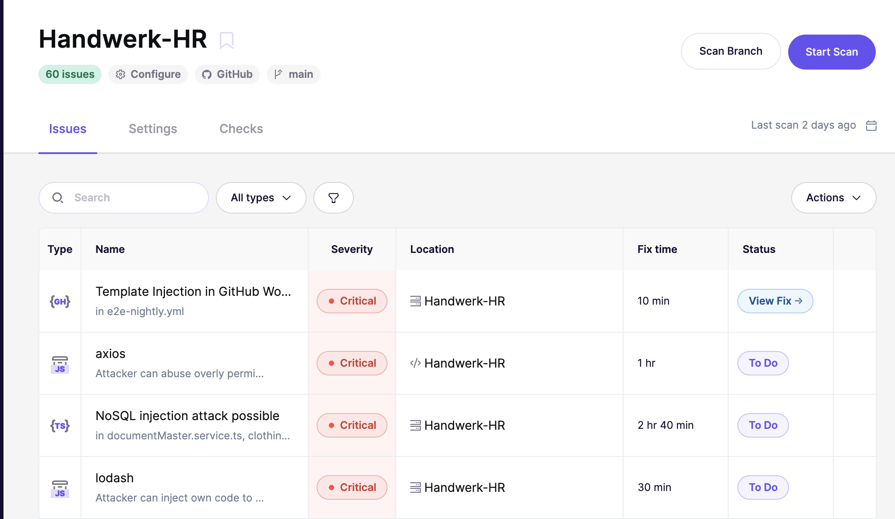

# Security

This page covers how we keep secrets out of Git, which versions we treat as stable, and what happens when a vulnerability is found. It lives under backend docs because the API holds secrets, auth, and most of the attack surface. Scanning product: [Aikido Security](https://help.aikido.dev/).



## Stable versions

The current stable application version is 2.0.0 in both `client/package.json` and `server/package.json`. Node is major 20 (CI uses `"20"`). Express is `^5.1.0`, Prisma Client `^7.3.0`, React `^19.2.0`, and Sentry for the API `^11.12.0`. When you report a finding or open a PR, assume this stack unless the PR itself bumps a version.

## Secrets and environment variables

Real secrets never belong in Git. `.env` is gitignored at the repo root, in `client/`, and in `server/`. GitHub secret scanning and push protection watch for known credential shapes on push. Aikido also scans for leaked credentials and dependency issues.

Configure values under the host (Render env, GitHub Actions secrets/variables). Do not paste them into READMEs, issues, or committed sample files.

## When a vulnerability is found

Triage first: confirm it is real, note severity, and check whether production or staging is exposed. Contain next: revoke leaked secrets, remove them from the repo if needed, and update host secrets; or upgrade a vulnerable dependency on a branch. Fix through a normal pull request into `main`. Verify with Aikido or the relevant scan, then deploy via the usual Render path. Close the loop in Aikido or GitHub and reply to the reporter.

We do not silently ignore open critical or high findings on the stable 2.0.0 line.

## Response times

We aim to acknowledge a report within 1–2 business days. Critical or high issues (especially leaked secrets or auth bypass) start containment the same day we confirm them. Medium or low issues go into the next normal fix cycle, still with that acknowledgement. Please include the affected version, steps to reproduce, and whether any secret may already have been exposed.

## Validation

Incoming bodies and params are validated with Zod schemas under [`server/src/schemas/`](../../server/src/schemas/). Controllers parse with those schemas before calling services. Do not trust raw `req.body` fields beyond that boundary.

## Rate limiting

Render / Cloudflare can absorb big DDoS floods. That is not the same as app rate limiting. We still need limits in Express so one IP cannot hammer login or the whole API forever.

We use `express-rate-limit` in `server/src/middleware/rateLimit.middleware.ts`:

- Soft global ceiling: 1000 requests / 15 minutes per IP
- Tighter on `/auth`: 20 requests / 15 minutes per IP (login, register, refresh, password reset)
- Skipped for uptime (`GET /`, health), `/webhooks/…`, and `/internal/cron/…`
- Off in Jest unless `RATE_LIMIT_IN_TEST=1`
- Over limit → HTTP 429 with a short JSON message

`trust proxy` is set so the limiter sees the real client IP behind Render:

```ts
// server/src/server.ts
app.set("trust proxy", 1);

app.use(globalLimiter);
app.use("/auth", authLimiter, authRoutes);
```

Rough shape of the limiters:

```ts
// server/src/middleware/rateLimit.middleware.ts
export const globalLimiter = createRateLimiter({
    windowMs: 15 * 60 * 1000,
    max: 1000,
    skip: (req) => shouldSkipGlobalRateLimit(req),
});

export const authLimiter = createRateLimiter({
    windowMs: 15 * 60 * 1000,
    max: 20,
    message: {
        message: "Too many auth attempts, please try again later",
    },
});
```

Password-reset still has its own domain check (about 2 emails / 5 minutes per user) in `auth.service.ts`. That stays in addition to the HTTP limiters.

## Habits to keep

Confirm `.env` stays ignored. Prefer the smallest safe dependency upgrade when Aikido or GitHub advisories flag a package. Keep JWT, Stripe, and AWS keys only in Render or Actions secrets.
