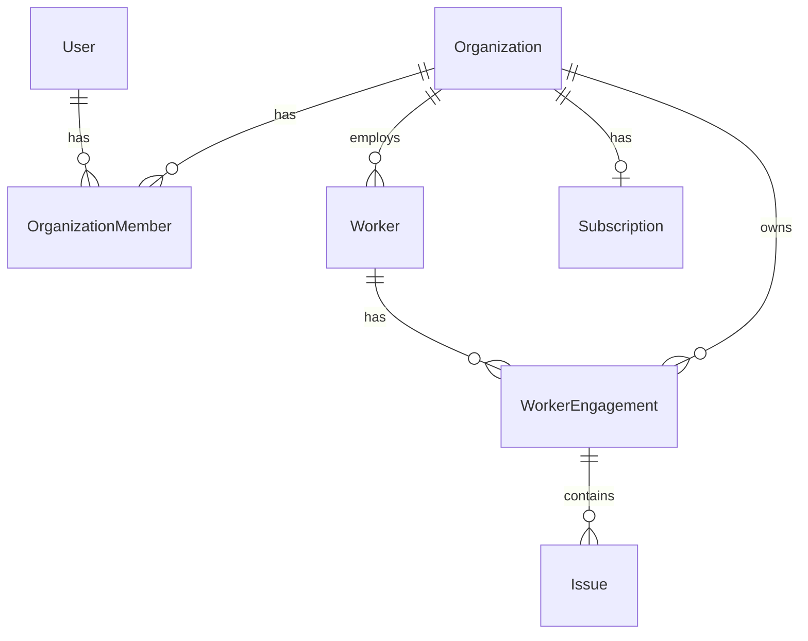
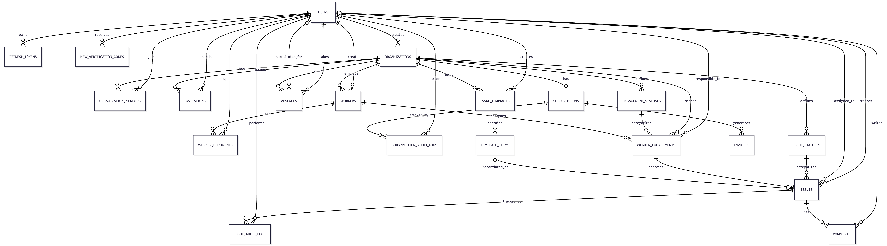

# Conceptual Data Model

High-level view of the main business entities and how they relate. Use this for onboarding and design discussions; for exact columns and constraints, use the [physical model](./physical-model.md) and [`server/src/prisma/schema.prisma`](../../server/src/prisma/schema.prisma).

## Core ideas

- **User** — a person who can sign in. A user may belong to several **organizations** via **organization membership** (`admin` or `worker`).
- **Organization** — the tenant boundary (billing, workers, templates, integrations).
- **Worker** — a tradesperson tracked by an organization (not the same as a login user).
- **Worker engagement** — an onboarding, transfer, or offboarding lifecycle for a worker; owns tasks/issues, documents, and related materials.
- **Issue / task** — work items on an engagement (templates, comments, mentions, audit trail).
- **Subscription / invoice** — Stripe-backed billing for the organization.
- **Questionnaires, documents, integrations** — supporting entities for forms, generated files, and external accounts (e.g. Microsoft).

## Diagram

If the diagram and this page disagree with `schema.prisma`, trust the Prisma schema and open a docs update.
