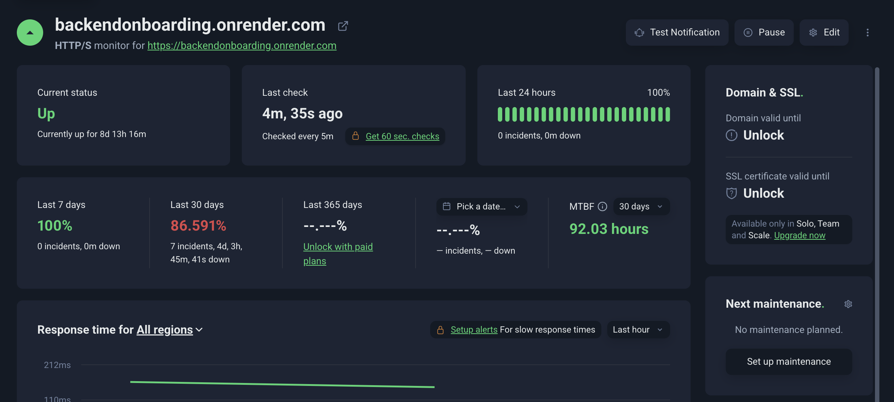
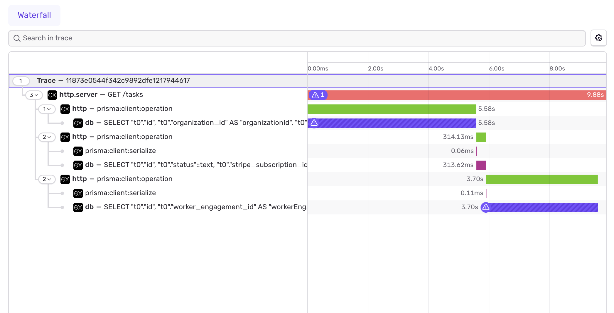
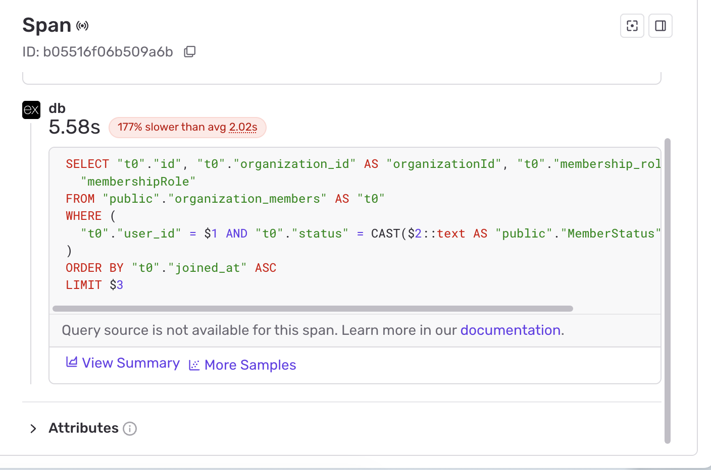

# Observability Deep Dive — PRs #225 and #226

API: Render web service (Express + Prisma)  
PRs: [#225](https://github.com/MaddoxSciuchetti/Handwerk-HR/pull/225), [#226](https://github.com/MaddoxSciuchetti/Handwerk-HR/pull/226)

SE_46 evidence for the observability side of Performance, Scaling, and Observability.

---

## Purpose

One issue that reminded me of the importance of having observability and being able to search for request ids came up when I was visiting a user and she was trying out a new feature. Of course the feature failed and I did not know directly what to do. This was before me having implemented any form of request ids or tracing. What continued was a rather long search for the error instead of being able to pinpoint the issue right away. This makes me grateful for my current implementation. Whenever there now is a mistake I can pinpoint the issue much faster due to having a much better insight into my request response cycle and being able to gather more information quickly to understand what the problem is about.

That experience is why I built #225 and #226. I added structured logging (pino), request correlation, and Sentry so that when something fails in production I can search Render by a concrete id and see the matching access line, error line, and related domain events — and so that exceptions and slow requests also show up in Sentry. UptimeRobot still covers whether the host is reachable at all.

What I would do differently next time:

1. Decide earlier that Sentry owns tracing when the DSN is set, instead of discovering dual-OTEL confusion later. I initially wired OpenTelemetry as well; running both tracing stacks at once was a mistake, so when `SENTRY_DSN` is set the app skips my OTEL NodeSDK and lets Sentry Performance own the spans.
2. Lean fully on Sentry Performance for traces (which is what staging/production do now with the DSN set).
3. Run the load probe (`ops/loadtest`) on staging and paste concurrent-user numbers — done; results live in `docs/backend/load-probe.md`.

---

## PR #225 — Structured logging (pino) and request ids

### What I did

I replaced ad-hoc `console.*` on the hot path with a shared pino logger and request correlation so every meaningful request can be found again later.

I added request id middleware that assigns or reuses `X-Request-Id`, binds that id into AsyncLocalStorage for the rest of the request, and tags the active Sentry scope when one exists. Access log middleware then writes one `http.access` line when the response finishes, including `durationMs`, status, and path. Health and root checks stay at debug when they succeed so they do not flood the info stream on Render.

The shared logger always merges `requestId`, `traceId`, `spanId`, and optional `userId` / `orgId` into the fields I log, and redacts secrets such as passwords, tokens, and cookies.

On hot paths — Stripe webhooks, Microsoft Graph, mention mail, and cron via `cronLog` — I use the same `event` + `outcome` shape as the HTTP access logs. The error handler logs `http.error` and returns `requestId` in the 500 JSON body so I can copy that id from a failing client and search it. On SIGTERM/SIGINT I flush logs; I also log unhandled rejections and uncaught exceptions before exit. I documented the search habit for Render logs and how to log from new features under `docs/backend/` and `ops/`.

### Effect

When something fails, I copy `requestId` from the 500 body or the `X-Request-Id` response header, paste it into Render logs, and get the access line, the error line, and related domain events for that same request, including how long it took. That is the difference from sitting with a user and not knowing where to start.

### Learning

For day-one ops, putting `requestId` on the response and writing structured access/error logs mattered more than anything else. Keeping health checks quiet at info level also mattered so deploy noise does not bury real failures.

---

## PR #226 — Sentry error monitoring and tracing

### What I did

I put a product UI on top of the log foundation so I do not only rely on grepping Render.

Server `instrument.ts` initializes `@sentry/node` from `SENTRY_DSN` before the rest of the app. When that DSN is set, I skip my OTEL NodeSDK so two tracing stacks do not fight (the mistake I made earlier). I register Express `setupExpressErrorHandler` and keep my JSON error formatter; unexpected 500s become Sentry issues while I still write structured logs for Render.

```ts
// server/src/instrument.ts
import * as Sentry from "@sentry/node";
import { NODE_ENV, SENTRY_DSN } from "@/constants/env";

if (SENTRY_DSN) {
    Sentry.init({
        dsn: SENTRY_DSN,
        environment: NODE_ENV,
        tracesSampleRate: NODE_ENV === "production" ? 0.1 : 1.0,
    });
}
```

```ts
// server/src/index.ts — Sentry owns tracing when the DSN is set
import { isSentryEnabled } from "./instrument";
import { startTracing } from "./observability/tracing";

if (!isSentryEnabled) {
    startTracing(); // leftover path; staging/production use Sentry instead
}
```

On the client, `instrument.ts` initializes `@sentry/react` with TanStack Router tracing and session replay, using `VITE_SENTRY_DSN` at build time. If `SENTRY_AUTH_TOKEN` is present, Vite can upload source maps so production stacks stay readable. I also emit Sentry metrics `http.server.duration` and `http.server.5xx` from the access log path, and I tag the Sentry scope with `request_id`, `org_id`, and the user id so an issue lines up with what I search in Render.

### Effect

I still use Render when I already have a `requestId` and want the full log trail. Sentry is where exceptions get grouped and where I can set alerts when a route starts erroring or getting slow even though UptimeRobot still says the host is up.

### Learning

I need one tracing owner per process. The client DSN has to exist at frontend build time (`VITE_*`); the server DSN is a runtime env on the API service — easy to misconfigure across two Render services if I am not careful.

---

## UptimeRobot versus Sentry

UptimeRobot tells me whether the host is reachable. It HTTP-pings the production API host (`backendonboarding.onrender.com`) about every five minutes and records uptime and response time. That check hits the public root route `GET /`, which only responds with `here` — it is not a separate `/health` or `/healthz` endpoint (those paths are only treated as quiet in the access log if they appear; the live probe is `/`).

Sentry is for when the host is up but requests are failing or slow.



In project `handwerk-hr-server` → Alerts / Monitors I can create monitors for:

- a spike in `http.server.5xx` or failure rate
- p95 of `http.server.duration` (for example on `/tasks`) above a budget such as 2000 ms

---

## Reading a Sentry trace (example: `GET /tasks`)

Sentry Performance records a **trace** for sampled HTTP requests: a waterfall of spans (HTTP → Prisma → SQL). This is tracing. The purple “Slow DB Query” flags are performance issues on spans, not a dump of every application exception (those live under Issues).

Here is a real staging trace for `GET /tasks` that took **9.88s** while the Starter instance was under load:



Opening the first slow DB span shows the SQL Sentry captured:



```sql
SELECT "t0"."id", "t0"."organization_id" AS "organizationId",
       "t0"."membership_role"::text AS "membershipRole"
FROM "public"."organization_members" AS "t0"
WHERE (
  "t0"."user_id" = $1
  AND "t0"."status" = CAST($2::text AS "public"."MemberStatus")
)
ORDER BY "t0"."joined_at" ASC
LIMIT $3
```

That SQL is the auth membership lookup. After the JWT is verified, `authenticate` loads the user’s first active org so the request gets `orgId` / `membershipRole`, then tags the Sentry scope so this span lines up with the same user and request id:

```ts
// server/src/middleware/authenticate.ts
const member = await prisma.organizationMember.findFirst({
    where: { userId: payload.userId, status: "active" },
    select: { organizationId: true, membershipRole: true },
    orderBy: { joinedAt: "asc" },
});

req.userId = payload.userId;
req.orgId = member?.organizationId;
req.membershipRole = member?.membershipRole;

if (isSentryEnabled) {
    Sentry.setUser({ id: req.userId });
    const scope = Sentry.getCurrentScope();
    if (req.orgId) scope.setTag("org_id", req.orgId);
    if (req.requestId) scope.setTag("request_id", req.requestId);
}
```

Sentry’s Node SDK (initialized in `instrument.ts` with `tracesSampleRate`) creates the `http.server` transaction and the nested Prisma/`db` spans automatically. The long **5.58s** on this tiny `LIMIT 1` query was wall-clock under load (pool/CPU wait), not a heavy plan — the next span in the same request (subscription lookup) was only ~313ms, then the real `/tasks` `findMany` took ~3.70s. Same overloaded host; different place in the waterfall.

---

## How to prove it works (manual)

1. Hit an API route → response has `X-Request-Id`.
2. Force a 500 → body includes `requestId`.
3. In Render → API logs, search that id → `http.access` / `http.error`.
4. With DSNs set, open Sentry Performance → pick a `GET /tasks` transaction → confirm the span waterfall (as above).
5. Trigger a test exception once → confirm in Hadox `handwerk-hr-server` / `handwerk-hr-frontend`, then resolve it.

Unit coverage: redact helper, request-id middleware, cron log bridge.

---

## Still interesting

- Caching hot org-scoped reads (`/tasks`, templates, license status)
- Propagate `X-Request-Id` from the Vite `apiClient` end-to-end
- Cron Sentry check-ins for anniversary / deactivation jobs

---

## Env vars

| Variable            | Where             | Role                                      |
| ------------------- | ----------------- | ----------------------------------------- |
| `LOG_LEVEL`         | API runtime       | pino level                                |
| `SENTRY_DSN`        | API runtime       | `@sentry/node` (owns tracing when set)    |
| `VITE_SENTRY_DSN`   | Frontend build    | `@sentry/react`                           |
| `SENTRY_AUTH_TOKEN` | Frontend CI/build | Optional source maps                      |
